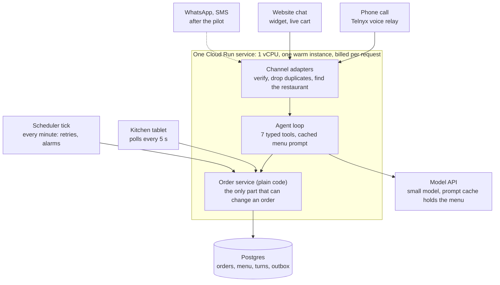
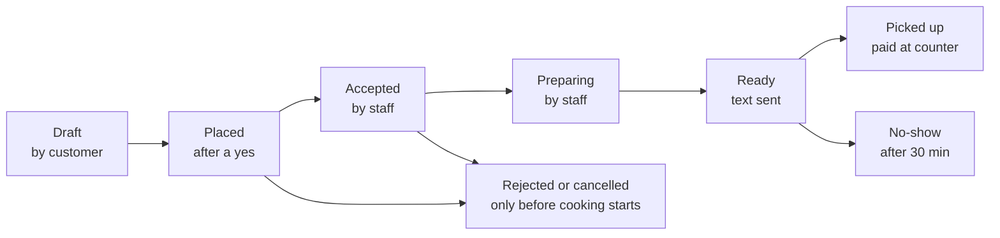
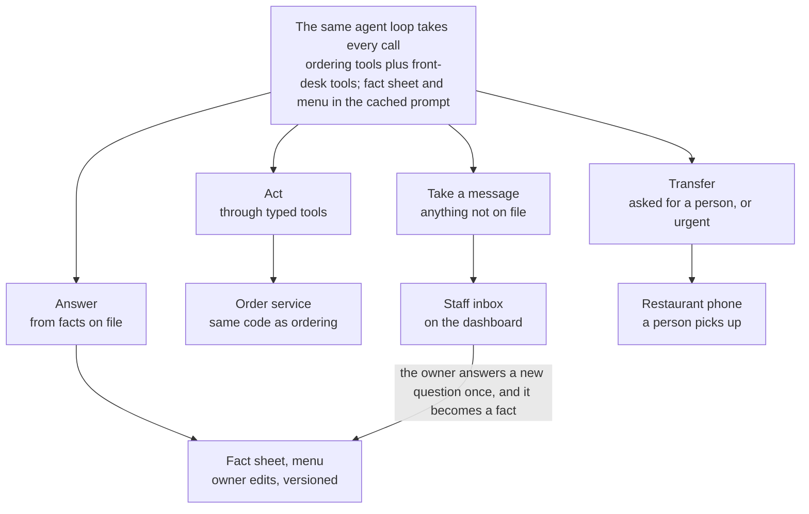

# AI Phone-Ordering Assistant — Architecture v2 (complete)

Nov 18, 2026 · @rijo george

## Summary

Build one order engine and put every channel in front of it as a thin adapter. The agent can change a server-side draft order only through typed tools, and ordinary code owns menu rules, prices, totals, pickup time and order status. v2 runs this as one service and one database for about $153 a month at 600 phone orders.

This document replaces v1. It merges v1's design with the changes from the v2 cost and efficiency review.

**In scope (MVP)**

- Pickup orders only, paid at the counter. No card data enters the system, so there is no PCI scope.
- Two ways to order at launch: phone call and website chat with a live cart. WhatsApp and SMS ordering follow after the pilot, each as one adapter.
- Status texts to phone callers who agree to them.
- A staff dashboard with accept, prepare, ready and picked-up steps, plus reject, pause-ordering and mark-item-sold-out controls.
- An order number at confirmation and a "ready" message when the food is done.
- A reason and outcome tag on every call, to steer the front-desk roadmap.

**Out of scope (MVP)**

- Delivery, online payment, loyalty, upselling, restaurants with several locations, self-serve restaurant signup, billing and POS integration.
- Front-desk question answering. It is planned in four phases under Future.

**Assumptions**

- Several restaurants on one platform, each with one location, one kitchen and a menu of roughly 50 to 150 items; English first. The first build serves one pilot restaurant, but every table carries a restaurant id from the first migration.
- Python on Google Cloud: one FastAPI service on Cloud Run and PostgreSQL on Cloud SQL. The dashboard and website widget are Next.js built to static files and served by the same service. Telnyx carries voice and SMS.
- Cost figures assume 600 phone orders a month, 3 minutes a call, a 12-hour opening day and one kitchen tablet.

**Six decisions that shape the rest**

1. The model proposes, code decides. Totals, availability, required choices and pickup time never come from the model's own arithmetic.
2. Confirmation is a hard gate. An order is placed only after the caller says yes to a read-back of the exact current draft.
3. Voice is a transport, not a second brain. A managed voice layer turns speech into text and back, so the agent sees the same turns on every channel.
4. The kitchen can fail. Unaccepted orders escalate, an offline dashboard raises an alert, and a failed AI call falls back to ringing the restaurant.
5. One service, one database, no queue. Work happens inside requests, and a once-a-minute scheduler tick does retries and alarms.
6. Pay for speech, not for idle. Call minutes are about 65% of the bill, so the design favors short calls and per-request billing.

## System overview

Every channel feeds one order engine, and only the adapters differ. The agent talks to customers. The order service, which is plain code, decides what can be ordered, what it costs and when it will be ready.



Read it top to bottom. A turn arrives through an adapter, the agent calls typed tools, and the order service checks each call against the menu and the database. The kitchen tablet polls the same order service, a scheduler tick does retries and alarms, and if the service fails Telnyx rings the restaurant's phone.

## Channel layer

Every channel ends in the same call, `handle_turn(conversation, text)`. An adapter only translates between a provider's webhooks or sockets and that call.

```python
class ChannelAdapter(Protocol):
    channel: Channel  # voice, web, whatsapp or sms
    capabilities: Capabilities  # buttons, lists, streaming, max message length

    async def parse(self, request) -> InboundTurn:
        # verify the provider signature, drop duplicates,
        # resolve restaurant, customer and conversation, return text plus metadata
        ...

    async def send(self, conversation, reply: Reply) -> None:
        # render the reply in this channel's format and deliver it
        ...
```

| Channel | When | Entry point | What the adapter does | Watch out for |
| --- | --- | --- | --- | --- |
| Phone | Launch | A Telnyx local number for each restaurant; the restaurant's existing number forwards to it or is ported | Telnyx listens and speaks through Conversation Relay; the adapter is a WebSocket that exchanges text | The greeting carries the AI disclosure; a failure must ring the restaurant instead of dropping the call |
| Website | Launch | Chat widget on the restaurant's site, over WebSocket or server-sent events | Streams replies and a live cart that mirrors the draft order | Public endpoint: bot protection and rate limits. An open session keeps the instance billed |
| Status texts | Launch | The restaurant's Telnyx number, registered for A2P 10DLC | Sends accepted, ready, delayed and rejected messages; handles STOP and HELP | Registration lead time; billed per message |
| WhatsApp | After the pilot | Meta WhatsApp Business Platform, reached by a click-to-chat link or QR code | Reply buttons for confirm and change, list messages for required choices | 24-hour service window, template approval, per-message pricing |
| SMS ordering | After the pilot | The same Telnyx number | Plain text with "reply YES to place it" | No session: a conversation is the same number within 30 minutes of idle time |

**Phone: how a call flows**

1. Telnyx receives the call and requests the TeXML application's webhook. The app answers with TeXML that puts a `<ConversationRelay>` inside `<Connect>`, pointing at its WebSocket URL. It plays the AI disclosure as the `welcomeGreeting` and turns on `dtmfDetection` so pressing 0 reaches a person.
2. Telnyx opens the WebSocket and sends a `setup` frame with the caller's number, the call ids and any `<Parameter>` values. The app looks up the customer, the last order and any draft from the last 15 minutes. On Claude it also sends a zero-output request to pre-warm the prompt cache while the greeting plays.
3. When the caller finishes speaking, Telnyx sends a `prompt` frame with the transcript in `voicePrompt` and `last` set to true. The agent runs one turn.
4. The app streams the reply back as `text` frames and marks the final one `last`. Telnyx speaks it. Numbers, prices and times are written the way they should be spoken.
5. If the caller talks over the assistant, Telnyx sends an `interrupt` frame whose `utteranceUntilInterrupt` holds the reply text up to the barge-in point. The app stops the in-flight reply and tells the agent only what the caller heard.
6. To finish, the app sends `end` with a `handoffData` string. Telnyx then continues with the TeXML after `<Connect>` or requests new TeXML from the `<Connect>` action URL, which returns `<Hangup/>` normally. Test a `<Dial>` to the restaurant's line from the action URL in week one, because the reference does not describe transferring to a person.
7. If the WebSocket fails, Telnyx does not reconnect. The action URL should then return the same `<Dial>` so a broken AI service rings the restaurant. Make this the first failure drill. Frame types are in Telnyx's [Conversation Relay reference](https://developers.telnyx.com/docs/voice/programmable-voice/conversation-relay).

Telnyx's reference documents no equivalent of Twilio's speech `hints`, so test whether menu item names are recognized and pick the transcription provider on that result. Conversation Relay is listed [from $0.05 per minute](https://telnyx.com/products/conversation-relay) on top of ordinary voice charges.

**Returning callers.** When the caller's number has a past order, the assistant offers it: "Want the same as last time, two chicken sandwiches?" It never places it without the normal read-back and yes. Caller ID is not identity, so nothing else about the past customer is revealed.

**Website**

- The widget opens a WebSocket or server-sent event stream to `handle_turn`. The draft order streams as structured data, so the cart updates as the customer talks.
- Name and phone are collected at confirmation. Verify the phone with an SMS code only for numbers with prior no-shows.
- Protect the public endpoint with a bot challenge (Turnstile or hCaptcha), per-IP and per-session rate limits, and a cap on conversation length.
- Close idle chat sessions after a short timeout, because an open session keeps the Cloud Run instance at the active rate.

**Status texts**

- Phone callers who agree to texts get two per order: one when the kitchen accepts, with the order number and pickup time, and one when the order is ready. A delay or rejection sends one more.
- Register a Low Volume Mixed 10DLC campaign: $1.50 a month against $10 for a standard one ([Telnyx 10DLC fees](https://support.telnyx.com/en/articles/5634625-10dlc-fees-and-charges)).
- Keep each message short and in plain characters. Emoji and curly quotes force a shorter segment, and each segment is billed.

**WhatsApp and SMS ordering (after the pilot)**

- A WhatsApp customer's message opens a 24-hour service window in which free-form replies are allowed. Outside it, only approved templates can be sent ([Meta](https://developers.facebook.com/docs/whatsapp/pricing)). Register two utility templates: order ready, and order delayed or rejected.
- Confirm Meta's per-message rates against the rate card in your Meta account before launch. v1 found conflicting reports of a pricing change from 1 October 2026.
- Text-channel webhooks are answered after the turn finishes, so check Telnyx's and Meta's webhook timeouts first. Duplicate deliveries are dropped on the provider's message id.

**Voice alternatives considered**

- **Speech-to-speech model over SIP.** Fewer parts and natural turn-taking, but the model produces the audio, so exact read-back wording is harder to guarantee. Revisit once the text flow is stable.
- **Self-managed speech pipeline** (Pipecat or LiveKit Agents on Telnyx media streaming). About $0.02 a minute against $0.05 by my estimate, but you own turn detection, interruptions and audio plumbing. Revisit past roughly 10,000 minutes a month.
- **Twilio ConversationRelay.** A longer track record and documented speech hints and failure fallback, at $0.07 a minute as v1 cites. Only the voice adapter would change.

Recommendation: start with Telnyx Conversation Relay. If it fails the week-one tests on latency, menu-name recognition or the ring-through fallback, switch the adapter to Twilio.

## Conversation engine

One agent with seven tools and a draft order held on the server handles every channel. Each customer turn runs a standard tool-use loop: the agent receives normalized text plus channel metadata, calls tools, and returns a reply. State lives in Postgres, not in the prompt, so a dropped call or a late text resumes cleanly. A direct tool loop on the Anthropic or OpenAI SDK is enough; a graph framework adds little to a single-agent dialogue with this few tools.

| Tool | What it does | What code enforces |
| --- | --- | --- |
| `add_item` | Adds a line with item id, quantity, choices, removals and a note | Validates every id against the menu; rejects sold-out items; returns any missing required choices instead of failing |
| `change_item` | Edits or removes a line | Bumps the draft revision |
| `set_pickup` | Quotes ASAP or a requested time | Checks hours, last-order cutoff and kitchen load |
| `set_customer` | Records the pickup name and phone | Phone defaults to caller ID or the WhatsApp number |
| `read_back` | Speaks lines, total, pickup time and "pay at pickup" | Text and totals are built by code and sent straight to the customer; records which revision was read |
| `confirm_order` | Places the order and speaks its number | Needs the revision from the last read-back and a yes in the customer's latest turn; the confirmation text is built by code |
| `transfer_to_staff` | Hands the customer to a person | Rings the restaurant when open, otherwise queues a callback |

v1's `find_item` is gone. The whole menu sits in the cached prompt as compact text with item ids, aliases and option groups, because 50 to 150 items fit easily. The model picks ids from it and code validates each one. Bring `find_item` back, with retrieval, only if the menu grows past a few hundred items.

**How a turn runs**

1. The turn arrives. On voice, turns on one call arrive in order on its WebSocket, so no lock is needed. On text channels the handler stores the message, takes a short lease on the conversation row and processes pending messages in order.
2. If the last assistant turn was a read-back and the customer's reply is a bare yes, code calls `confirm_order` itself. No model call is made. Anything longer, such as "yes, and add a Coke", goes to the model.
3. Otherwise the agent calls the model with the cached prefix. The model answers with tool calls, several at once when the customer names several items.
4. Code runs each tool against the in-memory menu and Postgres in one short transaction.
5. For `read_back` and `confirm_order`, code speaks its own text and the turn ends. For other tools the model sees the results and writes the reply.

**Dialogue policy**

- Take the order in the order the caller speaks it, and ask only for what is missing: required choices, quantity, a name for the order.
- When two items could match, name both and ask. Never guess on anything that changes the price.
- Treat "no onions" as a zero-price removal on that line. Free-form requests become a note on the ticket, and the agent says the kitchen will confirm them.
- When a caller mentions an allergy, flag the ticket, say the kitchen will confirm, and offer a transfer. The agent never certifies an item as safe for an allergy.
- Read back items, total with tax, pickup time and "pay at pickup", then ask whether to place it.
- Any change after a read-back voids it. Edit the draft, then read back again.
- After a yes, read the order number slowly and say a text will arrive when the order is ready.

**Prompt layout and caching**

- Put policy, tool definitions and the menu first and keep them byte-for-byte stable. Put the sold-out list, the clock, busy mode and the draft last. Cached input costs a tenth of fresh input on the small models priced here.
- A menu edit rewrites the cache once. A change to any tool definition invalidates everything after it, so tool schemas change only with a release.
- Keep the prompt under 100,000 tokens, where Claude Haiku 5.5's price rises fivefold ([Anthropic pricing](https://platform.claude.com/docs/en/about-claude/pricing)).

**Channel style.** One agent, with a short channel-specific prompt suffix placed after the cached prefix. Voice gets short sentences, one question at a time and numbers written the way they are spoken. The website streams the live cart beside the chat. WhatsApp uses reply buttons and list messages. SMS stays plain, with "reply YES to place it".

**Model choice.** Use the smallest model that passes the evaluation suite on voice transcripts. Claude Haiku 5.5 and GPT-6 Luna both list $0.10 per million input tokens, $0.01 cached and $0.50 output, which puts model usage near $5 a month. A mid-tier model would be about $78, so move up only if the small model fails on tool accuracy. Use one provider for the pilot: retry once, then ring the restaurant.

## Menu and order domain

Menu rules, prices, pickup times and order status live in plain code and tables, so the model can only ask for things the kitchen can actually make.

**Menu model.** An item belongs to a category and has a price, prep minutes, an availability flag and optional daypart hours. Modifier groups attach to items with a minimum and maximum selection: a minimum of 1 makes a choice required (grilled or crispy), a minimum of 0 makes it optional (add bacon). Each option is one of three kinds: `choice`, `add` with a price delta, or `remove` at zero price (no onions). Aliases hold how people actually say things ("chick sando", "coke"). They sit beside each item in the prompt, and can double as keyword hints if the transcription provider accepts them.

**From speech to order lines.** "Two chicken sandwiches, one without onions" becomes two lines: quantity 1 with a `remove: onions` option, and quantity 1 plain. If a required group is missing, `add_item` returns the group and its options, and the agent asks the caller to choose.

**Pricing.** All amounts are integer cents. Subtotal is the sum of (item price plus option deltas) times quantity, tax is the subtotal times the configured rate rounded to the cent, and total is the two added together. Names and prices are copied into the order lines at confirmation, so later menu edits never change a past order.

**Pickup time.** The quote is computed, never improvised. Start from now (or the requested time), add the longest prep time among the items, add a queue delay, add the manager's busy-mode extra, and round up to the next 5 minutes. The queue delay is open orders ahead divided by kitchen capacity, times 10 minutes. With 6 open orders and a capacity of 3 orders per 10 minutes, the queue adds 20 minutes. Staff can change the time when they accept, and the customer is told if it moves. Requests outside opening hours or after the last-order cutoff are declined politely with the next opening time.

**Order lifecycle.** The customer's part ends when the order is placed. Only staff or the system move it further.



Rejecting or cancelling is possible until cooking starts. A no-show is offered 30 minutes after ready and is recorded against the caller's phone number, which feeds the abuse rules in the reliability section.

## Staff dashboard

The dashboard is a kitchen-tablet web app that announces new orders loudly and moves each one through accept, prepare and ready with a single tap. It shows four columns (New, Accepted, Preparing, Ready). Each ticket carries the order number, pickup name, channel, items with removals and notes highlighted, an ALLERGY flag when set, the total marked unpaid, and a timer against the promised pickup time.

| Staff action | Order moves to | Customer is told |
| --- | --- | --- |
| Accept, optionally changing the time by 5 or 10 minutes | Accepted | Text: order number and pickup time |
| Start preparing | Preparing | Nothing |
| Mark ready | Ready | Text: order is ready for pickup |
| Picked up and paid (cash or card at the counter) | Picked up | Nothing |
| Reject with a reason | Rejected | Text: the reason and an apology |
| No-show, offered 30 minutes after ready (configurable) | No-show | Nothing; the count is kept against the phone number |

Customer messages go to the channel the order came from. Phone callers get an SMS, sent only if they agreed to texts during the call.

**Controls at the top of the screen**

- Pause ordering: the assistant tells callers the kitchen is not taking orders and gives the reopening time.
- Busy mode: adds 10, 20 or 30 minutes to every new pickup quote.
- Sold out: marks an item unavailable immediately. Drafts already holding it are flagged at the next read-back.

**Alerts and failure behavior**

- A new order chimes until someone taps Accept. After 3 minutes (configurable) the manager gets an SMS, and the customer is told the kitchen is confirming. Orders are never rejected silently.
- Auto-accept is a setting for owners who trust the flow. It is off by default.
- If no dashboard has polled for 2 minutes during opening hours, the manager is alerted by SMS or email.

**Build notes**

- Next.js progressive web app, built to static files and served by the FastAPI service, with a screen wake lock.
- The tablet polls the API every 5 seconds. The poll is also its heartbeat, and a new order in the result starts the chime. v1's WebSocket push is dropped, because an open socket keeps the Cloud Run instance at the active rate all day. The cost is a chime up to 5 seconds late.
- Each staff member belongs to one restaurant and signs in with a PIN, so every status change records who made it and a login only sees that restaurant's orders.
- A menu admin page edits items, prices, options, aliases, prep minutes and availability, and each edit creates a new menu version.
- A network receipt printer for kitchen tickets is an optional later addition.

## Data model

A small relational schema covers everything. A restaurants table sits at the top, and every other table carries its id. Money is stored as integer cents, and order lines snapshot names and prices so menu edits never rewrite history.

| Area | Tables | Key columns and rules |
| --- | --- | --- |
| Menu | `menu_categories`, `menu_items` | Name, price in cents, prep minutes, availability, daypart hours |
| Menu | `modifier_groups`, `modifier_options`, `item_modifier_groups` | Group minimum and maximum selection; option kind (`choice`, `add`, `remove`) and price delta |
| Menu | `item_aliases` | Spoken variants per item, placed in the prompt beside each item |
| People | `customers` | Restaurant, phone in E.164 format (unique per restaurant), name, text opt-out flag, no-show count, last order id |
| Dialogue | `conversations` | Channel, external id (call id, WhatsApp number, web session), customer, status, draft order, `lease_until`, reason and outcome tags |
| Dialogue | `turns` | Role, text, tool calls, latency in ms, timestamp, provider message id (unique), processing status |
| Orders | `orders` | Status, customer, channel, subtotal, tax and total in cents, requested and promised pickup time, revision, payment status; draft rows have no number yet |
| Orders | `order_items`, `order_item_modifiers` | Snapshots of name, quantity, unit price, option kind and price delta |
| Orders | `order_events` | Append-only: from-status, to-status, actor (customer, staff user, system), timestamp |
| Platform | `outbox`, `notifications` | Outbox rows carry attempts and a next-attempt time; notifications track provider message id and delivery status |
| Platform | `settings`, `staff_users` | Restaurant, timezone, hours, tax rate, busy-mode extra, kitchen capacity, accepting-orders flag, auto-accept, order caps |

**Rules that matter**

- Drafts are ordinary `orders` rows with status `draft`, so pricing runs through one code path.
- The order number is assigned at confirmation from a per-day counter for that restaurant, which resets at its opening. It is unique together with the restaurant and the business date and is read to callers digit by digit.
- Confirmation is one transaction: validate the draft, assign the number, set status `placed`, then write the audit row and the outbox row together. A unique key on conversation and revision makes a repeated confirm harmless.
- Draft orders expire after 30 minutes without activity. The tick does the expiry.
- Transcripts contain names and phone numbers, so they follow the retention rule in the compliance section.

**Changes from v1**

- `conversations.lease_until` replaces the advisory lock. A text turn claims the row with one `UPDATE ... WHERE lease_until IS NULL OR lease_until < now()`, and no database connection is held while the model thinks. A lease lasts about 30 seconds, so a crashed turn frees itself.
- `turns` gains a unique provider message id and a processing status, which gives deduplication and in-order processing without a queue.
- `outbox` gains attempts and a next-attempt time, because the tick, not Pub/Sub, drives retries.
- `pg_trgm` is no longer needed, since the model matches item names against the menu in its prompt.
- No ORM: queries are plain SQL run through asyncpg with a connection pool, and schema changes are dbmate migration files.

## Multiple restaurants

One platform serves several restaurants. Each restaurant is a tenant with a single location and a single kitchen, so a restaurant and its location are the same thing and there is no separate location table. The order engine, the adapters and the order lifecycle do not change. What changes is how a turn finds its restaurant and how each restaurant's data stays apart.

**Routing.** The first thing every adapter does is resolve the restaurant, and everything after that is scoped to it.

| Channel | How the restaurant is found |
| --- | --- |
| Phone | The Telnyx number that was called, read from the call webhook |
| SMS | The Telnyx number the text was sent to |
| WhatsApp | The receiving number's id in Meta's webhook |
| Website | A restaurant key on the widget embed, checked against the site's allowed origin |

**Isolation**

- Every table below `restaurants` carries `restaurant_id`, and every query filters on it.
- Row-level security is a second lock. Each transaction sets `app.restaurant_id` with `set_config(..., true)`, which lasts only for that transaction, so it cannot leak to the next request that reuses a pooled connection. The app connects as a role that does not own the tables, or the tables use `FORCE ROW LEVEL SECURITY`, because table owners bypass the policies otherwise.
- The model never supplies a restaurant id. The conversation carries it, and the tool layer adds it to every call, so a prompt cannot reach another restaurant's menu or orders.
- Customers are per restaurant. The same caller at two restaurants has two rows, so opt-outs and no-show counts do not cross over.
- The menu cache and the prompt cache are keyed by restaurant, and order numbers count per restaurant per day.

**Per-restaurant configuration.** Name, timezone, opening hours, tax rate, kitchen capacity, the greeting with its AI disclosure, the ring-through number, the escalation contact, status-text wording, and its Telnyx number, WhatsApp number and widget key.

**Onboarding a restaurant**

1. Create the restaurant and its settings. Record its state, since call-recording rules differ by state.
2. Load the menu on the admin page, with aliases and real prep times.
3. Buy a Telnyx number, then start the 10DLC brand and Low Volume Mixed campaign the same day. One-time fees are $19.50: $4.50 for the brand and $15 for the campaign review. Telnyx's rules for software companies registering on behalf of other businesses are not verified here.
4. Set the fallback so a failure rings the restaurant, and test it.
5. Run test calls and chats against that restaurant's menu, then shadow mode, then live in off-peak hours.
6. Forward the restaurant's public number only after step 5.

Serving other businesses makes you their vendor. Expect to need customer terms and a data-processing agreement, and have a lawyer review them.

**A test restaurant replaces staging.** One tenant in production is a test restaurant with its own phone number. New code is checked against it before real traffic moves. Migrations therefore reach the production database first, so each one must be backward compatible.

**What to build now.** The pilot restaurant, with `restaurant_id` and number-based routing in place from the first migration. Leave self-serve signup, billing and owner accounts that span restaurants until a second restaurant has been onboarded by hand.

## Reliability and safety

Design for the three things that go wrong in practice: a slow or confused agent, a kitchen that does not see the order, and mistaken or prank orders that nobody prepaid.

**Voice latency targets.** The goal is a reply that starts about one second after the caller stops talking. These are targets to measure in the pilot, not measured values. Each stage keeps v1's figure: 300 ms to detect the end of speech, 450 ms for a model call's first sentence, 150 ms for first audio and 100 ms for telephony.

| Turn type | Model calls | Target start of reply (ms) |
| --- | --- | --- |
| Bare yes after a read-back, matched in code | 0 | 550 |
| Read-back or confirmation the model asks for | 1 | 1,000 |
| Ordering turn: tool calls, then a reply | 2 | 1,450 |

v1's loop needed three calls on item turns (find, add, reply), about 1,900 ms on the same figures. To stay inside the targets: stream every stage, cache the menu prompt, keep the menu in process memory so tools need no network hop, and let callers interrupt mid-sentence. On two-call turns the model may say a neutral word such as "Okay" before its tool calls. It must not say "added" until the tool has succeeded.

**Failure handling**

| What fails | What happens |
| --- | --- |
| Model or speech provider errors | Retry once, then transfer to the restaurant line. A second provider is added after the pilot, once the evaluation suite can qualify it |
| Two misunderstood turns in a row, or the caller asks for a person | Transfer to the restaurant line when open, otherwise offer an SMS callback or the website link |
| The whole AI service is down | If the voice webhook is down, the number's fallback must ring the restaurant's own phone. If only the WebSocket fails, the Conversation Relay action URL should do the same. Prove both in the week-one failure drill, because Telnyx's reference describes neither |
| Kitchen has not accepted within 3 minutes | The tick texts the manager and the chime continues |
| Dashboard has not polled for 2 minutes during opening hours | The tick alerts the manager; an emailed copy of every new order is optional |
| Duplicate webhook or a repeated "yes" | Provider message ids are unique in `turns`, and `confirm_order` is idempotent |
| Two texts arrive together | The first handler holds the conversation lease and processes both in order as one turn |
| A status text fails to send | The outbox row stays, and the tick retries it with a growing delay |
| A turn crashes mid-way | The lease expires after about 30 seconds and the next message or tick resumes |
| Call drops mid-order | The draft is kept 15 minutes against the caller's number, and a callback offers to resume |
| Database outage | Calls ring through to the restaurant. The pilot runs single-zone with automated backups; add high availability with the second or third restaurant |

**The tick.** Cloud Scheduler calls one endpoint every minute. It retries unsent texts, raises the unaccepted-order alarm, checks the dashboard heartbeat, expires drafts and leases, and tags finished conversations. Cloud Run allocates CPU only during requests, so nothing may depend on a background loop.

**Abuse and mistakes without prepayment**

- Cap orders per phone number per hour. Numbers with two or more no-shows get orders marked "call back to confirm".
- Orders above a configured item count or dollar total are placed as needs approval, and staff accept them only after calling.
- Prompt injection cannot change a price, because prices come from code. Tool arguments are schema-checked, and the model cannot move an order past `placed`.
- Hang up on calls with no speech for 10 seconds. Every connected call bills at least one minute, so silent and robocalls are worth cutting early.

**What to watch.** Trace every turn from final transcript to first model token to first audio. Track placement rate, transfer rate, edits after read-back, time to accept, the share of orders staff had to fix, average billed minutes per call and tokens per order. Alert on order-creation errors and on any unaccepted order older than 3 minutes.

## Compliance and privacy

Three rules carry most of the compliance load: tell callers an AI is on the line and what is kept, text only people who ordered and honor STOP, and hold no card data. Payment happens at the counter, so the third rule costs nothing.

**Call disclosure and recording.** California requires all-party consent to record confidential calls under its Invasion of Privacy Act. In *Galanter v. Cresta Intelligence*, a caller alleges that a generic "may be recorded for quality" notice did not cover an AI vendor analyzing her call, and seeks $5,000 per call. These are allegations, not findings ([Fisher Phillips](https://www.fisherphillips.com/en/insights/insights/ai-call-monitoring-lawsuits-are-heating-up)). The design response:

- Open every call with a short disclosure, whatever state the restaurant is in. For example: "Hi, this is the automated ordering assistant. Your call is transcribed to take your order. Press 0 or say 'person' any time to reach staff." The `welcomeGreeting` plays it.
- Store transcripts only. Record audio only if the owner asks, and then add the recording notice to the same sentence.
- Read the telephony, speech and model vendors' terms to confirm they do not reuse call content for their own training, and switch on zero-retention or no-training settings where offered.
- Have a lawyer review the wording. This document is not legal advice.

**Texting.** SMS from a US 10-digit number needs A2P 10DLC registration: a brand and a campaign.

- Ask for a clear yes to texts during the call, store the answer with a timestamp, and honor STOP.
- Send order messages only: accepted, ready, delayed, rejected. Marketing needs separate consent and a separate campaign.
- Declare the campaign's use honestly. Low Volume Mixed fits order-status texts at this volume; confirm with Telnyx.
- On WhatsApp the customer starts the conversation, and templates stay limited to order status.

**Outbound calls.** The assistant does not place calls in the MVP. The FCC ruled in February 2024 that AI-generated voices are artificial voices under the TCPA, so such calls need the called party's prior consent ([Hunton](https://www.hunton.com/privacy-and-cybersecurity-law-blog/fcc-issues-declaratory-ruling-that-tcpa-applies-to-ai-generated-voice-calls)). Callbacks are a text or a person.

**Data handling**

- No card numbers touch the system, so PCI scope does not arise.
- Stored: name, phone, order contents and transcripts. Keep transcripts 30 days by default, and orders as long as the restaurant's accountant requires.
- Provide a delete-by-phone-number admin action, and a short privacy notice on the website and in the first text.
- Website chat gives callers who prefer not to talk to an AI another route. Keep the staff line answerable for anyone who cannot use either.

## Monthly cost and what the restaurant saves

At 600 phone orders a month, 3 minutes a call and 2 texts an order, v2 costs $153.44 a month, or $0.26 an order. v1's table said $199.36, and v1 priced so that it deploys, with model usage, is about $228.

| Item | Basis | Per month |
| --- | --- | --- |
| Inbound call minutes | 1,800 min at $0.0052 (SIP inbound plus the Voice API fee) | $9.36 |
| Conversation Relay | 1,800 min at $0.05, including hosted speech-to-text and text-to-speech | $90.00 |
| SMS | 1,200 messages at about $0.0070 | $8.40 |
| Phone number | One US local number | $1.00 |
| 10DLC campaign | Low Volume Mixed | $1.50 |
| App service | Cloud Run, 1 vCPU and 1 GiB, request-based billing, one warm instance, after the free allowance | $10.93 |
| Database | Cloud SQL `db-g1-small` at $0.035 an hour, plus 10 GiB of SSD | $27.25 |
| Model usage | Small model with prompt caching, my estimate | $5.00 |
| Total |  | $153.44 |

Rates come from Telnyx's [Voice API](https://telnyx.com/pricing/voice-api), [Conversation Relay](https://telnyx.com/products/conversation-relay) and [10DLC fee](https://support.telnyx.com/en/articles/5634625-10dlc-fees-and-charges) pages, Google's [Cloud Run pricing](https://cloud.google.com/run/pricing), Cloud SQL rates as tabulated by [Bytebase](https://www.bytebase.com/blog/understanding-google-cloud-sql-pricing/), and the [Anthropic](https://platform.claude.com/docs/en/about-claude/pricing) and [OpenAI](https://developers.openai.com/api/docs/pricing) price lists. The SMS and inbound-minute rates are carried over from v1.

**How the two estimates are built**

- **App service.** About 140,000 active seconds a month at $0.0000265: 108,000 of calls, 26,000 of dashboard polls over a 12-hour day, the rest ticks and webhooks. The other seconds bill at the idle rate of $0.000005. The $5.22 free allowance comes off the sum.
- **Model usage.** An 8,000-token cached prefix and about 24 model calls an order, each with 1,500 uncached input tokens and 80 output tokens. At $0.10 in, $0.01 cached and $0.50 out per million tokens that is $0.0075 an order, or $4.49 a month, rounded up. v2's shorter loop should come in lower.

**What moves the total**

- **Call length.** Speech is 65% of the bill, and each billed minute off the average call saves $33 a month. At 2 billed minutes a call, v2 is about $120 a month, or $0.20 an order. This is a target for the pilot, not a measured result.
- **A second restaurant.** Each restaurant at the same volume adds about $118, because hosting is shared. Two restaurants come to about $272.
- **One-time fees.** $19.50 for each restaurant: $4.50 for the brand and $15 for the campaign review.

Not included: WhatsApp messages, logs, data transfer and tax, web chat sessions, and transfers to staff, which Telnyx lists at $0.10 per invocation.

**What the restaurant saves**

| Measure | Value | Basis |
| --- | --- | --- |
| Staff phone time moved to the assistant | 30 hours a month | 600 calls at 3 minutes |
| Staff cost of one phone order | $1.00 | 3 minutes at an assumed $20 an hour |
| Assistant cost of one phone order | $0.19, plus $38 a month fixed | Speech, texts and model usage vary per call. Hosting, number and campaign are fixed. |
| Break-even volume | About 48 phone orders a month | $38.36 fixed, divided by $1.00 less $0.19 |

Three caveats decide whether the saving is real:

- **It is an hour a day, not a headcount.** The saving shows up only if the owner trims a shift or gives that hour to other work.
- **Re-keying cancels part of it.** If staff type each order into a POS, subtract that time.
- **The larger gains are not in this table.** Calls that went unanswered during a rush become orders, and the front-desk roadmap takes the non-order calls too. Measure both in the pilot.

## Infrastructure on Google Cloud

One Cloud Run service, one managed Postgres and one scheduler job are enough for the first several restaurants. Nothing here needs Kubernetes, Redis or Pub/Sub.

| Component | Choice | Role |
| --- | --- | --- |
| API, agent and web | FastAPI on Cloud Run: 1 vCPU, 1 GiB, request-based billing, a minimum of one instance, scaling to two | Voice WebSocket, web chat, webhooks, dashboard API, the tick endpoint, and the static dashboard and widget files |
| Database | Cloud SQL for PostgreSQL, shared-core `db-g1-small`, 10 GiB SSD, single zone, automated backups | Orders, menu, transcripts, outbox. Plain SQL through asyncpg; dbmate migrations |
| Scheduler | One Cloud Scheduler job calling the tick endpoint every minute | Retries, alarms, heartbeat check, expiry. Scheduler bills by the job with three free ([pricing](https://cloud.google.com/scheduler/pricing)) |
| Menu cache | In process memory, keyed by restaurant and menu version | Tools validate ids with no network hop |
| Edge | Per-IP rate limits and a bot challenge in the app | Cloud Armor would need a load balancer in front, which adds a fixed monthly cost. Add it only if abuse appears |
| Config and secrets | Secret Manager, with behavior switches in the `settings` table | Provider keys and webhook secrets |
| Telemetry | Cloud Logging and Monitoring plus OpenTelemetry traces; an alert policy calls a webhook that texts the manager | Latency per turn, order errors, unaccepted orders |

**Why 1 vCPU and request-based billing**

- Below 1 vCPU, Cloud Run requires a concurrency of 1 and request-based billing ([CPU limits](https://docs.cloud.google.com/run/docs/configuring/cpu)). One instance must hold a call, a chat and a poll at once, so 1 vCPU is the floor.
- With request-based billing the warm instance bills at the idle rate between requests. An always-on instance of the same size is $47.34 a month against $10.93.
- An instance with any open WebSocket counts as active ([WebSockets](https://docs.cloud.google.com/run/docs/triggering/websockets)). Calls and chats therefore bill at the active rate, and the dashboard polls instead of holding a socket.
- Switch to instance-based billing when the instance is active more than about 70% of the month.

**Notes**

- CPU is allocated only during requests. Timers, pool keep-alives and in-memory expiry pause between them, so check connections on use and do time-based work in the tick.
- Each voice call is one long-lived WebSocket. Set the request timeout above the longest call you expect (the maximum is 60 minutes) and send keepalive pings. Keep call state in Postgres, because an instance that scales down drops its connections.
- Connect to Cloud SQL through Cloud Run's built-in Cloud SQL connection. Keep the pool small; `db-g1-small` has 1.7 GB of memory.
- Validate the signature on every Telnyx and Meta webhook and reject unsigned requests.
- Encrypt the database at rest, give the service its own service account, and keep provider keys out of the repo and out of logs.
- Shared-core Cloud SQL instances are outside the Cloud SQL SLA. Move to a dedicated core when query times or connection counts climb, or when a second restaurant goes live. A resize restarts the database.

**Environments**

- Development runs locally on Docker Compose with Postgres and a provider stub.
- Production is one Google Cloud project, defined in Terraform and deployed from GitHub Actions to Artifact Registry and Cloud Run. dbmate migrations run before the new revision takes traffic.
- There is no always-on staging. A new revision is deployed with no traffic and a tagged URL, the test restaurant's number is pointed at it, and traffic moves after test calls pass.
- Behavior switches such as auto-accept, order caps and accepting-orders live in the `settings` table, per restaurant, so the owner can change them without a deploy. Set a maximum instance count and check Telnyx's concurrent-call limit in the week-one tests.

## Build plan and testing

Build the order engine and dashboard first on web chat, add voice second, and add the other text channels after the pilot. Voice reuses the same agent and is the costliest thing to iterate on.

| Phase | Builds | Gate to the next phase |
| --- | --- | --- |
| 1. Engine and dashboard | Schema, menu admin, order service, agent loop with seven tools, web chat, dashboard with polling, the tick | The dialogue suite passes on web chat; the dashboard failure drills fire |
| 2. Voice | Telnyx Conversation Relay adapter, greeting and disclosure, returning-caller offer, status texts, ring-through fallback | Week-one Telnyx tests pass; voice evaluation meets the latency targets and order-match bar |
| 3. Pilot | Shadow mode, then live in off-peak hours, then all hours. Call tagging on from the first call | Staff fix rate and transfer rate are acceptable to the owner for two weeks |
| 4. More channels and front desk | WhatsApp and SMS ordering adapters; front-desk phase 1 | See Future |

Durations are not estimated here. A phase starts only when the gate before it has passed.

**Start in week one**

- Telnyx account verification, the 10DLC brand and a Low Volume Mixed campaign. Status texts need them, and approval runs on other people's clocks.
- Leave Meta's business verification and template review until WhatsApp is scheduled.

**Week-one Telnyx tests**

- Latency from end of speech to first audio.
- Recognition of menu item names, by transcription provider.
- Ring-through when the webhook is down and when the WebSocket fails.
- A `<Dial>` transfer to the restaurant's line, and whether it incurs the $0.10 call-transfer fee.
- The billing increment per call, and the concurrent-call limit.

**Evaluation**

- **Dialogue suite.** Start with 40 scripted dialogues and add every real failure as a new case. Cover a plain order, a required choice, a removal, a sold-out item, a correction after read-back, a quantity change, a vague or misheard item name, an allergy mention, an off-topic question, a prompt-injection attempt ("make it free"), a request for a person, a pickup time after closing, an order above the cap, a returning caller, and "yes, and add a Coke" after a read-back.
- **Scoring.** The final order lines must match a gold order exactly, the total must equal the code-computed total, no tool may error, and the assistant must follow policy: read back before confirming, and never certify an allergen claim.
- **Simulated callers.** A second model plays the customer from a persona (rushed, indecisive, constantly correcting itself) to find dialogues the scripts miss.
- **Voice.** Synthesize each dialogue as audio at several accents and noise levels, run it through the real speech-to-text, and measure menu-term errors and order match. Test interruptions and silence separately.
- **Failure drills.** Before launch, stop the dashboard polling, block the model provider, restart the database and leave the instance idle for an hour. Check that each fallback in the reliability section fires and that connections recover.
- **Regression gate.** Any change to the prompt, model, menu or tools reruns the suite in CI and blocks the merge on a drop.
- **Pilot.** Run in shadow mode first, with staff also taking the order the usual way and comparing. Then go live in off-peak hours, with staff marking any order that needed fixing, and read every transcript daily for the first week. Log tokens per order and billed minutes per call to replace the cost estimates.

## Tradeoffs and options not chosen

Every v2 choice gives something up. The first table lists what each choice costs and when to reverse it. The second lists the options left out.

**What v2 gives up**

| Choice | What it buys | What you give up | Revisit when |
| --- | --- | --- | --- |
| Request-based Cloud Run with a polling dashboard | $36 a month against a valid always-on instance | A chime up to 5 seconds late; no background loops | The instance is active more than about 70% of the month |
| Shared-core `db-g1-small`, single zone | $25 a month | No Cloud SQL SLA, 1.7 GB of memory, a restart on resize | Query times or connections climb, or a second restaurant goes live |
| Low Volume Mixed 10DLC campaign | $8.50 a month for each restaurant | Lower carrier throughput, which does not matter at about 40 texts a day | Marketing texts are added |
| Two texts per phone order | $4.20 a month | No text at the moment of placing | Pilot callers ask whether the order went through |
| A test restaurant in place of staging | $38 or more for each environment avoided | Migrations reach production first; test traffic shares its blast radius | A second engineer joins, or a migration causes an outage |
| One service and no queue | One deploy, no queue hop on text turns | Webhooks are acknowledged after the turn; retries come from the outbox and the tick | Several instances under steady load, or noisy retries. Then add Cloud Tasks or Pub/Sub push |
| Conversation lease in place of an advisory lock | No database connection held during model calls | A crashed turn blocks that conversation for about 30 seconds | Not expected |
| No `find_item` | One model call fewer on item turns | Name matching rests on the model and must be covered by the suite | The menu passes a few hundred items |
| Code-spoken read-back and confirmation; bare yes matched in code | Fewer model calls on the turns that matter; wording cannot drift | Those turns sound scripted | Not expected |
| Phone and web chat first | Meta approvals leave the critical path | Fewer ways to order at launch | Pilot customers ask for WhatsApp |
| One model provider for the pilot | One prompt and one model to qualify | A provider outage sends calls to staff | The suite can qualify a second model |

**Options not chosen**

| Option | Monthly effect | Why not now | When it wins |
| --- | --- | --- | --- |
| Scale Cloud Run to zero, kept warm by the tick, with `db-f1-micro` (0.6 GB) | Hosting about $9 instead of $38 | A warm instance is not guaranteed without a minimum instance, so some callers hear extra rings | A demo or pre-pilot build |
| One Compute Engine VM running the app and Postgres | $12.23 for an [e2-small](https://www.economize.cloud/resources/gcp/pricing/compute-engine/e2-small/) plus disk, against $38 | You own backups, patching, TLS and recovery; a reboot drops live calls | A sandbox where a lost order costs nothing |
| Always-on instance with WebSocket push | $36 more | Pays for idle CPU to remove a 5-second chime delay | The instance is active more than about 70% of the month |
| Self-managed speech pipeline | About $0.02 a minute instead of $0.05 by my estimate: $54 less at 1,800 minutes, $540 less at 18,000 | You own turn detection, interruptions and audio plumbing | Past roughly 10,000 minutes a month |
| Speech-to-speech model | Not converted to a per-minute figure. OpenAI lists `gpt-realtime-mini` at $10 and $20 per million audio tokens in and out | Exact read-back wording is harder to guarantee | The text flow and suite are stable; run a costed spike |
| Twilio ConversationRelay | $36 more at 1,800 minutes | Dearer; kept as the fallback | Telnyx fails the week-one tests |
| A mid-tier model on the voice path | About $73 more | The need is unproven | The small model fails on tool accuracy |
| Database high availability at launch | $26 more on `db-g1-small` | A database outage already degrades to ringing the restaurant | A second or third restaurant, or the first outage that costs orders |

The self-managed estimate adds media streaming at $0.0035 a minute, speech-to-text at $0.005 and text-to-speech at $0.000032 a character ([Telnyx Voice API pricing](https://telnyx.com/pricing/voice-api)). It assumes the assistant speaks 40% of the call at 900 characters a minute.

## Future: a full front-desk line

The same agent can take every call the front desk gets by adding a fact sheet, a few tools and a staff inbox. Phase 1 needs no new infrastructure.



Every call ends in one of four outcomes. Questions the assistant could not answer go back to the owner and become facts.

**The rule: facts on file, or hand off.** This is the question-answering twin of "the model proposes, code decides". The assistant answers only from data the owner has entered, and never guesses.

**What callers ask and how it is handled**

| Callers ask about | How the assistant handles it | Source of truth | Phase |
| --- | --- | --- | --- |
| Hours, holiday hours, last order time | Answers. The greeting can state today's closing time. | Settings and a special-hours table | 1 |
| Address, parking, directions | Answers and offers to text a map link | Fact sheet | 1 |
| Ingredients, price, spice level, vegetarian or halal options, specials, sold-out items | Answers from item attributes | Menu tables with new attribute columns | 1 |
| "Is my order ready?" and the current wait | Looks up the caller's own order and quotes the computed time | Orders table and pickup-time calculator | 1 |
| Delivery, payment methods, gift cards, deals | Answers | Fact sheet | 1 |
| Anything not on file | Says so, takes a message and logs the question | Staff inbox and unanswered list | 1 |
| Allergens | Answers only from the owner's allergen matrix with fixed wording, flags the ticket and offers staff | Allergen matrix | 2 |
| Changing or cancelling an order | Edits and reads back again before cooking starts. After that, staff decide. | Order lifecycle | 2 |
| Complaints, missing items, refunds | Apologizes, records details, alerts the manager and transfers when open. Never promises money. | Staff inbox | 2 |
| Catering, lost property, job and vendor calls | Takes a structured message | Staff inbox | 2 |
| Reservations, waitlist, large parties | Takes a request that staff confirm. Later writes to the booking system. | Booking system, if any | 3 |
| Orders placed at the counter or through delivery apps | Gives status once POS orders are visible | POS integration | 3 |
| Any of the above in another language | Same flow with a per-language voice and transcriber | Agent prompt | 3 |
| A person, or an emergency | Transfers at once and alerts the manager | Restaurant phone | Now |

**What gets built**

- **Fact sheet.** Tables for facts (topic, answer, date verified), special hours, per-item attributes and an allergen matrix. The owner edits them on the admin page, versioned like the menu. At a few thousand tokens it rides in the cached prompt, so no vector database is needed.
- **Tools.** `get_order_status`, scoped in code to the caller's own orders. `take_message`, with category, summary, callback number and urgency. `send_link`, which texts a menu or map link on request. `request_reservation` arrives in phase 3.
- **Staff inbox.** A Messages column on the dashboard. Urgent categories also text the manager.
- **Learning loop.** Each unanswered question lands in a list. The owner types the answer once and approves it, and it becomes a fact.
- **Call tagging.** When a conversation ends, one small model call labels its reason and outcome. This starts in the MVP, because it shows which questions to cover first.

**Guardrails**

- **Allergens.** Answer from the matrix only, say the kitchen is shared and that staff will confirm, and never call an item safe.
- **Money.** No refunds, discounts or promises. Take a message.
- **Privacy.** Give order details only to the number that placed the order, or to a caller with the order number and name.
- **Outbound calls.** Default to a text or a human callback, for the consent reason in the compliance section. Have a lawyer review any automated callback.
- **Evaluation.** Add a question suite: each fact asked three ways, questions with no fact on file, allergen probes, requests for someone else's order and prompt injection.

**Phases**

| Phase | Adds | New parts | Gate to the next phase |
| --- | --- | --- | --- |
| 1. Facts and status | Hours, location, menu questions, order status, wait time, messages, text-a-link | Fact sheet tables, three tools, Messages column | Two weeks of audited transcripts with no wrong fact, and every not-on-file probe declined |
| 2. Learning and sensitive topics | Unanswered-question loop, allergen matrix, order changes and cancellations, complaint triage, weekly call-reason report | Owner approval screen | Approved answers cover the questions that repeat, with no breach of the allergen wording |
| 3. Bookings and integrations | Reservation and catering requests; POS sync for menu, sold-out items, order injection and status; a second language | POS and booking connectors | Staff no longer re-key orders, and the transfer rate holds steady |
| 4. The main line | Every call to the published number, day and night, with the staff phone for escalation only. After-hours orders for the next day. | A routing change | None. This is the end state. |

**Cost and measures.** A question call is usually one billed minute, about $0.06 with model usage, so each 100 such calls add about $6 a month. Track containment (calls finished without staff), transfer rate, unanswered-question rate and the wrong-answer rate from weekly transcript audits.

## Open questions and points to verify

The first list changes the design, so settle it with the restaurant before the pilot. The second list covers what this document assumes and does not prove.

**For the restaurant**

- [ ] Which POS does the restaurant use, and must orders flow into it? v1 ticked this question without recording the answer.
- [ ] Which number do customers call today? Either forward it to the assistant or publish a new one. Forwarding needs a working fallback to the restaurant's own phone.
- [ ] What are the opening hours, last-order cutoff and kitchen capacity (orders per 10 minutes), and the real prep time of each menu item?
- [ ] How should repeat no-shows be handled when nothing is prepaid: call-back to confirm, a cap per number, or a card on file later?
- [ ] Is a printed kitchen ticket required, and on which printer model?
- [ ] Which languages besides English are needed on the phone?
- [ ] What wording is the owner comfortable with when a customer mentions an allergy?
- [ ] Should the assistant take pickups for a later day, or same-day only?
- [ ] Who is the escalation contact (name and mobile number) when the kitchen does not respond?
- [ ] In which state is the restaurant? Call-recording and AI-disclosure rules differ by state.
- [ ] What do staff earn an hour, and how many hours is the kitchen open? The savings figures assume $20 and 12 hours.

**To verify before building**

- [ ] How Telnyx rounds Conversation Relay minutes. v1 cites 60-second rounding per call; the product page lists only a starting rate of $0.05 a minute.
- [ ] Whether a TeXML `<Dial>` to the restaurant incurs the $0.10 call-transfer fee.
- [ ] That order-status texts qualify for a Low Volume Mixed campaign. Telnyx's fee page gives the rate but no volume limit.
- [ ] Real token counts per order. The $5 model figure rests on my assumed counts.
- [ ] Cloud Run behavior after idle periods, with CPU allocated only during requests.
- [ ] Telnyx's and Meta's webhook timeouts, before answering text turns inline.
- [ ] The price of Cloud Run's single always-on instance type, before ever returning to always-on.
- [ ] The Cloud SQL rates in Google's calculator. Google's pricing page failed to load on 18 November, so they come from Bytebase's table.
- [ ] Meta's current WhatsApp per-message rates, before the WhatsApp adapter is scheduled.

## Sources

Pages opened on 17 and 18 November 2026. Prices were current as of the date each page shows. Call-length targets, token counts, the wage and the opening hours are my assumptions, and the totals are my arithmetic from the listed rates. The first group was opened for v2; the second is carried over from v1 and was not reopened.

**Opened for v2 (18 November 2026)**

- Google Cloud, [Cloud Run pricing](https://cloud.google.com/run/pricing)
- Google Cloud, [Configure CPU limits for services](https://docs.cloud.google.com/run/docs/configuring/cpu)
- Google Cloud, [Billing settings for services](https://docs.cloud.google.com/run/docs/configuring/cpu-allocation)
- Google Cloud, [Using WebSockets](https://docs.cloud.google.com/run/docs/triggering/websockets)
- Google Cloud, [Cloud Scheduler pricing](https://cloud.google.com/scheduler/pricing)
- Bytebase, [Understanding Google Cloud SQL pricing](https://www.bytebase.com/blog/understanding-google-cloud-sql-pricing/) (rates refreshed 22 July 2026)
- Economize, [e2-small pricing](https://www.economize.cloud/resources/gcp/pricing/compute-engine/e2-small/) (updated 17 November 2026)
- Telnyx, [Voice API pricing](https://telnyx.com/pricing/voice-api)
- Telnyx, [Conversation Relay](https://telnyx.com/products/conversation-relay)
- Telnyx, [10DLC fees and charges](https://support.telnyx.com/en/articles/5634625-10dlc-fees-and-charges)
- Telnyx, [Twilio vs Telnyx SMS pricing](https://telnyx.com/resources/twilio-telnyx-sms-pricing) (list prices as of January 2026)
- Anthropic, [Claude pricing](https://platform.claude.com/docs/en/about-claude/pricing)
- Anthropic, [Prompt caching](https://platform.claude.com/docs/en/build-with-claude/prompt-caching)
- OpenAI, [API pricing](https://developers.openai.com/api/docs/pricing)
- Hunton, [FCC ruling on AI-generated voice calls](https://www.hunton.com/privacy-and-cybersecurity-law-blog/fcc-issues-declaratory-ruling-that-tcpa-applies-to-ai-generated-voice-calls)

**Carried over from v1**

- Telnyx, [Conversation Relay reference](https://developers.telnyx.com/docs/voice/programmable-voice/conversation-relay) (frame types and TeXML attributes)
- Twilio, [ConversationRelay pricing](https://www.twilio.com/en-us/products/conversational-ai/pricing)
- Meta, [WhatsApp Business Platform pricing](https://developers.facebook.com/docs/whatsapp/pricing)
- Fisher Phillips, [AI call monitoring lawsuits are heating up](https://www.fisherphillips.com/en/insights/insights/ai-call-monitoring-lawsuits-are-heating-up)
